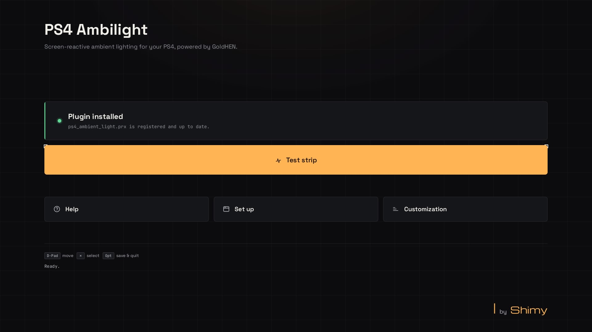
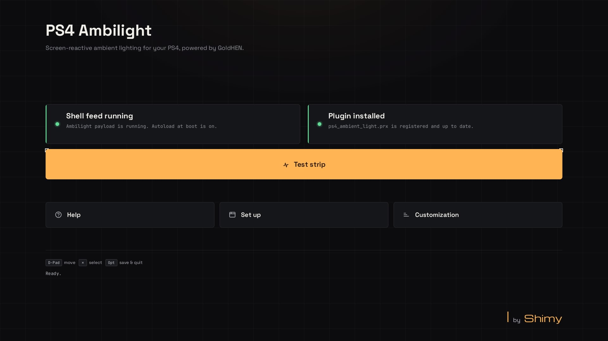
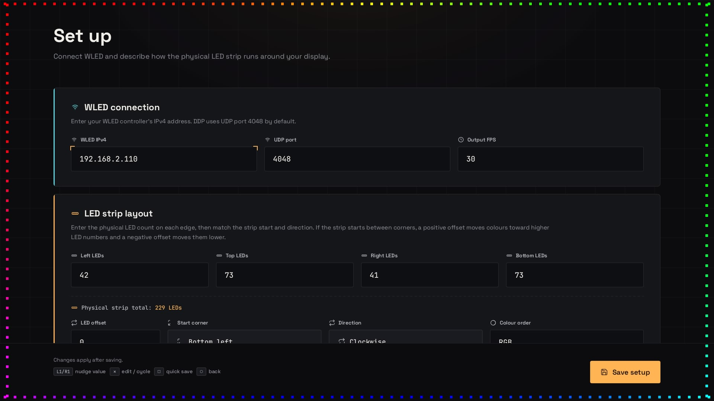
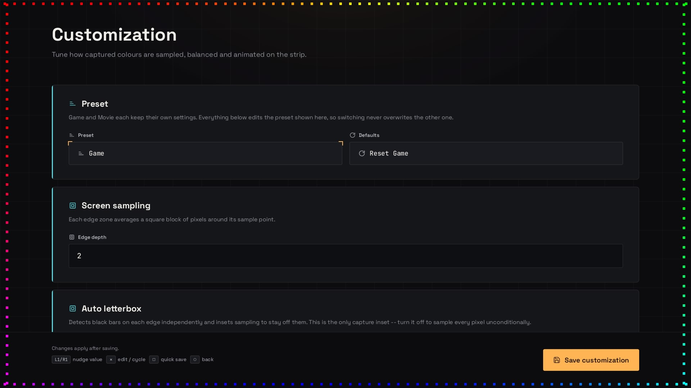
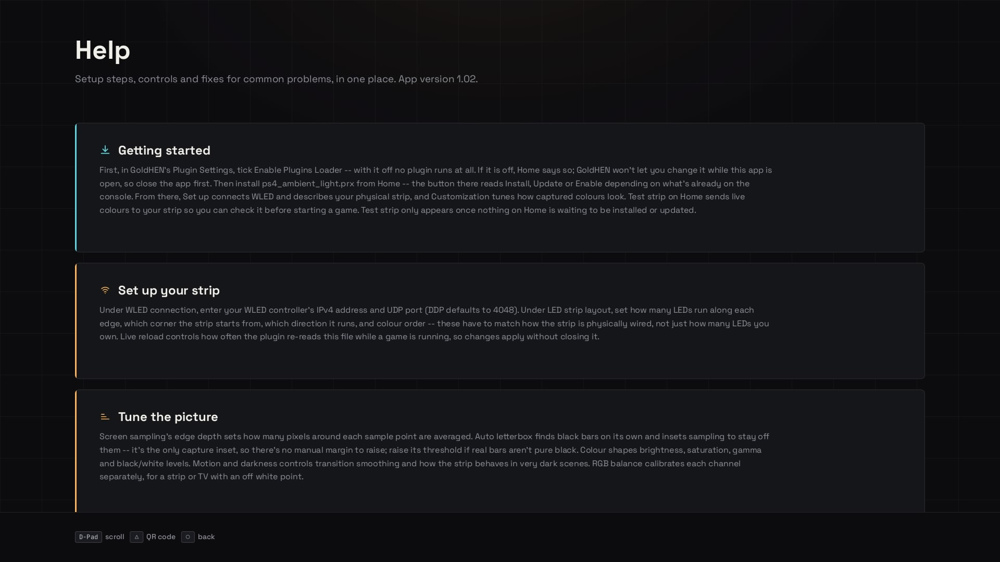

# PS4 Ambilight

<p align="center">
  
</p>

Ambilight for a jailbroken PS4, driven by a real [WLED](https://kno.wled.ge/) strip. A
[GoldHEN](https://github.com/GoldHEN/GoldHEN) plugin reads the console's own video output while
you play and streams the edge colors to WLED over the network. No capture card, no PC, nothing
plugged in between the console and the TV, no camera pointed at it. It works in Netflix and
YouTube as well as in games.

```
PS4 game or app (Netflix, YouTube, ...)
   |
PS4-Ambilight plugin (GoldHEN)
   |   DDP over your network
WLED controller
   |
LED strip
```

> [!NOTE]
> **Stuck, or want to report a game?** Start with [Help](#help). To tell us how a game behaves,
> see [Reporting a game](#reporting-a-game).

[Quick start](#quick-start) | [Help](#help) | [Set up your strip](#set-up-your-strip) |
[Configuration](#configuration) | [Reporting a game](#reporting-a-game) |
[How it works](#how-it-works) | [Building](#building-the-plugin) | [Support](#support-the-project) |
[Changelog](CHANGELOG.md)

## What you need

- A PS4 running [GoldHEN](https://github.com/GoldHEN/GoldHEN)
- A WLED controller with an LED strip, on the same network as the PS4
- The companion app `.pkg` from [Releases](../../releases)

That is all the hardware: the WLED controller and the strip.

The [shell feed](#shell-feed-optional), which lights the strip outside games too, is optional and
installs from the same app.

> [!IMPORTANT]
> Get GoldHEN running first. This project is a GoldHEN plugin plus a standalone companion app,
> not a jailbreak on its own.

## Tested on

| | |
|---|---|
| PS4 firmware (game plugin) | 9.00 and 12.52 |
| PS4 firmware (shell feed + standalone payload) | 9.00 and 12.52 |
| PS4 Pro | untested. Colors may be wrong there; if you have one, see [Reporting a game](#reporting-a-game) |
| GoldHEN | 2.4b18.9 and 2.4b18.10 |
| LED strip | WS2812B, 229 LEDs (73 top, 41 right, 73 bottom, 42 left), starting at the bottom left and running clockwise |
| Controller | WLED, latest release |

The shell feed and current standalone payload are confirmed working on firmware 9.00 and 12.52; other versions are untested, and any firmware not in the payload's list will most likely be refused; see [Shell feed](#shell-feed-optional).

Other setups very likely work too, since the plugin only depends on GoldHEN and a WLED controller
on your network. If you try a different firmware, GoldHEN version or strip, a note in an
[issue](../../issues) helps.

## What it does

- Reads the PS4's rendered video output directly, on the console
- Samples colors from zones along each screen edge
- Streams them to WLED over DDP every frame, on its own thread so the game isn't slowed down
- Detects letterbox bars, and SDR versus HDR, on its own
- Works in games and in streaming apps (Netflix, YouTube), in SDR and with the console's HDR
  setting on
- Keeps separate Game and Movie presets, and switches to Movie by itself in Netflix and YouTube
- Optionally lights the strip from the PS4's own Home screen, Settings and quick menu too, with
  the [shell feed](#shell-feed-optional) (off by default)

<p align="center">
  
  
</p>
<p align="center">
  
  
</p>
<p align="center">
  
</p>

## Quick start

1. In GoldHEN, turn on the plugin loader: open **Settings**, choose **★ GoldHEN ★**, go to
   **Plugin Settings** and tick **Enable Plugins Loader**. With it off, GoldHEN loads no plugins
   at all, this one included. The companion app checks this switch too: if it's off, Home says so
   ahead of everything else, but GoldHEN won't let you change it while an app is open, so you
   turn it on yourself with the app closed.
2. Install the companion app `.pkg` from [Releases](../../releases) like any other homebrew
   package. (To build it yourself, see [`companion-app/README.md`](companion-app/README.md).)
3. Open it. On **Home**, press the main button. It reads **Install**, **Update** or **Enable**,
   depending on what it finds, and puts the plugin in place:
   - **Install**: `ps4_ambient_light.prx` isn't on the console yet. Pressing it downloads the
     latest release build to GoldHEN's plugin folder.
   - **Update**: the `.prx` is installed but older than the latest release.
   - **Enable**: the `.prx` is present, but its `plugins.ini` entry is commented out or missing,
     so GoldHEN isn't loading it.
   - Once it's installed and enabled, the button becomes **Test Strip**.
4. Go to **Set up** and enter your WLED controller's IP address and your strip's layout. Details
   are in [Set up your strip](#set-up-your-strip). **Test Strip** stays locked until this is
   done, and pressing it before then shows a reminder. **Test Strip** also stays hidden while
   anything on Home is waiting to be installed, updated or repaired.
5. Press **Test Strip**. It sends live colors from the companion app straight to your WLED
   controller, so you can check wiring, layout and color order before trusting it in a game.
6. Start a game. There is nothing else to launch: the plugin hooks the video-out path itself, and
   if `wled_host` is set and the strip is reachable, it starts streaming on its own.
7. Optional: to light the strip outside games as well, set up the
   [shell feed](#shell-feed-optional).

If something is off, [Help](#help) is next.

## Help

The companion app's Help screen (Home, then Help) keeps to six short cards. This section is the
longer version. Pressing **△ Triangle** on that screen opens a QR code pointing at this heading,
so you can read it on a phone without typing a URL on a controller.

**Home says "Plugin loader is off", or nothing happens in any game.**
GoldHEN's plugin loader is a separate switch from the plugin's own `plugins.ini` entry, and with it
off GoldHEN loads no plugins for any game. Home reads the switch from GoldHEN's own settings file
(`/data/GoldHEN/config.ini`, `PluginLoader_Enabled` under `[PluginLoader]`) and, when it's off, puts
that first: Install, Update and Test Strip wait until it's on. Turn it on under **Settings**,
**★ GoldHEN ★**, **Plugin Settings**, **Enable Plugins Loader**. GoldHEN won't change it while a game
or app is running, and the companion app counts as one, so close the app first. The Home button for
this does exactly that, and Home picks the change up within a couple of seconds of you coming back.
The app only reads that file and never edits it: GoldHEN keeps the live value in memory, so editing
the file by hand doesn't turn the loader on and GoldHEN's menu would still show it off. If Home
never mentions the loader and a game still shows nothing, the settings file may not have that entry
(an older GoldHEN): Home only acts when the file says the loader is off. Check the switch in
GoldHEN's menu, and if the plugin still doesn't load after turning it on, restart GoldHEN.

**The strip stays completely dark.**
Re-check `wled_host` and `wled_port` under **Set up**. Confirm WLED's realtime UDP listener is
reachable from the PS4's subnet: no client isolation between them, and no firewall dropping UDP
4048. Press **Test Strip** first, because it shows whether the problem is reaching WLED at all or
something specific to capturing a game.

**Colors land on the wrong LEDs, or look rotated or scrambled.**
Revisit `led_start_corner`, `led_direction` and `color_order` together, see
[LED strip layout](#led-strip-layout). Getting one of them wrong usually makes the others look
wrong too. `led_offset` is the right tool for a simple fixed rotation, once those three are
correct.

**A game crashes as soon as the plugin is enabled, or one title's strip stays dark while others
work.**
Mortal Kombat 11 did both before v3.9: its display buffers are GPU-only and the CPU may not read
them. The plugin now asks the console first and, for a buffer like that, allows the read, so
update to the latest plugin release. If another title still does it, [report it](#reporting-a-game).
The report file shows how far the plugin got. More in
[`docs/debugging/gpu-only-buffers.md`](docs/debugging/gpu-only-buffers.md).

**Colors look badly wrong in an HDR title, not just slightly off.**
Make sure you're on the latest plugin release, then see
[HDR and pixel formats](#hdr-and-pixel-formats).

**Black bars or overscan are being sampled as picture content.**
This should correct itself within `auto_letterbox_stability_frames` re-checks once
`auto_letterbox_enabled` is on, which is the default. If it still happens, raise
`auto_letterbox_threshold` slightly when the bars aren't pure black (it is **Bar threshold** in
the companion app, shown as a percent). If it reacts too slowly to a bar appearing, shorten
`auto_letterbox_check_interval_frames` in the ini.

**The strip sticks on one color after I quit a game, the companion app crashes on close, or I
see an occasional flash of an unrelated color.**
All three were fixed in older releases, so update the plugin from **Home** and install the latest
companion app. The flash was WLED's own realtime-timeout color firing during a brief gap in
packets. The plugin now resends the last good color once a second, so that timeout can't fire.
Details are in the [Changelog](CHANGELOG.md).

**There is stutter while the light is active.**
It shouldn't happen by design. Sampling runs on its own worker thread, off the game's
render/flip hook, so a slow pass can't stall frame submission. If you do see stutter tied to
enabling the plugin, please report it.

**Test Strip is missing from Home.**
It only shows when nothing is waiting. If the plugin, or the shell feed with its switch on, needs
installing, updating, repairing or enabling, the button on Home does that instead, and Test Strip
comes back once it's done. Turning the Shell feed switch off removes its part of that check.

**Autoload at boot won't turn on.**
Pressing the row says what is missing, in this order: the Shell feed switch is off, the plugin
isn't installed or isn't enabled, or the shell feed files aren't installed yet. Fix that from
**Home**, then press it again. Turning it off always works.

**The strip flickers between two sources while the companion app is open.**
That was the app and the shell feed both sending. With the Shell feed switch on, the app claims the
strip while Set up, Customization or Test Strip is sending and lets go when you leave or press the
PS button. The shell feed keeps running until you save the switch off, so if you turn it off and
the strip flickers, press **Save setup**. Update the app if it still happens, and
[report it](../../issues).

**Home's button shows the wrong state**, for example **Install** after you already installed.
Fully close and reopen the companion app. A stale in-memory state from before an update can look
like this until the app restarts.

**The plugin update from Home fails or hangs.**
That path hasn't been exercised end to end on every network setup, see the known-limitations note
in [`companion-app/README.md`](companion-app/README.md). If it fails, download the `.prx` from
[Releases](../../releases) and drop it into GoldHEN's plugin folder by hand. The same goes for the
shell feed's two files: put `ps4_shell_feed.prx` in `/data/ps4-ambilight` and
`ps4-ambilight.bin` in `/data/payloads`.

## Set up your strip

### Connecting to WLED

Both the plugin (`[network]` in the ini) and the companion app's **Set up** screen want the same
two values:

- **WLED host**: your WLED controller's own IPv4 address on your LAN. This is *not* the PS4's
  address, and it isn't a hostname. Use plain dotted-decimal, because no `mDNS` or `.local`
  resolution is done.
- **WLED port**: defaults to **4048**, WLED's DDP port. Leave it alone unless you've moved WLED
  off its default.

This project speaks DDP (Distributed Display Protocol, originally specified by 3waylabs) only. It
does not use WLED's older Hyperion-style UDP-raw input or an Adalight serial protocol, and there
is no PS4 USB-serial path here. DDP is the simplest reliable fit for a plugin that has to run
inside someone else's game process every frame. See [WLED's own docs](https://kno.wled.ge/) for
how it implements the receiving side.

WLED needs no special "realtime mode" toggle. A DDP packet arriving on port 4048 puts the
affected LEDs into realtime override on its own. If packets stop, WLED falls back to its previous
state, or to its configured realtime-timeout color (see [Help](#help)).

### LED strip layout

Under `[layout]` in the ini, or **Set up**, then **LED strip layout** in the app:

| Setting | What it means |
|---|---|
| `led_count_top/right/bottom/left` | How many physical LEDs run along each screen edge. These have to match how many LEDs you actually own and where you cut or split the reel. Not a guess, not "close enough." |
| `led_start_corner` | Which corner physical LED index 0 sits at: `bottom_left`, `bottom_right`, `top_left`, `top_right`. |
| `led_direction` | Which way the strip runs from that corner: `clockwise` or `counterclockwise`. |
| `led_offset` | If the light show is *correct but rotated* around the border by a fixed number of LEDs, adjust this instead of the two settings above. It's a cheap way to nudge alignment without re-deriving start corner and direction from scratch. |
| `color_order` | Match your strip's actual wiring: `RGB`, `RBG`, `GRB`, `GBR`, `BRG` or `BGR`. Most WS2812B/NeoPixel strips are `GRB`, despite the name. |

Getting **any one** of start corner, direction or color order wrong tends to look like all three
are wrong: colors land in roughly the right *area* but the fine detail is scrambled and channels
look swapped. Fix them one at a time against **Test Strip**'s live preview rather than guessing
at a combination.

## Shell feed (optional)

The plugin lights the strip while a game or streaming app is on screen. The **shell feed**,
[`shell-feed/`](shell-feed/README.md), is a second plugin that lights it from the PS4's own Home
screen, Settings and quick menu the rest of the time, and steps aside whenever a game starts. It is
**off by default** and is confirmed working on firmware **9.00 and 12.52** with the current standalone payload
([support matrix](shell-feed/docs/support-matrix.md)). Other firmware versions are untested, and ones outside the payload's firmware list will most likely be refused. With it off, the companion app does nothing
shell-related at all.

1. Open **Set up** and go to the **Shell feed** card. Turn **Shell feed** on and press **Save
   setup**.
2. Back on **Home** a **Shell feed** banner appears next to the plugin's. Press the main button. It
   reads **Install shell feed**, or **Install all (3)** if the plugin isn't installed either. It
   downloads `ps4_shell_feed.prx` into `/data/ps4-ambilight` and the Ambilight payload `ps4-ambilight.bin`
   into `/data/payloads` (both folders are created if missing), and checks each file's SHA-256
   before keeping it. The app then reads **Shell feed installed**.
3. The Ambilight payload is what puts the shell feed into the console's compositor, so it has to run after
   GoldHEN loads. Either run it by hand from GoldHEN's **Payloader**, press **Launch Ambilight payload** on
   **Set up** (it sends the payload to GoldHEN's BinLoader, no reboot needed), or turn on
   **Autoload at boot** there. Autoload adds the Ambilight payload to GoldHEN's AutoRun list
   (`/data/GoldHEN/payloads.ini`) and leaves every other line in the file alone. If something goes
   wrong at boot, hold **L1** while GoldHEN loads to skip all AutoRun payloads for that boot
   ([details](shell-feed/docs/loading.md)).

The main button keeps the three files current afterwards:

| Home shows | Button | Meaning |
|---|---|---|
| Shell feed not installed | **Install shell feed** | neither file is on the console |
| Shell feed needs repair | **Repair shell feed** | one of the two is missing |
| Shell feed update available | **Update shell feed** | a file differs from the published build |
| any mix with the plugin | **Install all (n)** / **Update all (n)** | everything pending, plugin first |

The app can't install itself. When a newer companion app is out, Home shows **App update available** and Help's header
says so too. Press **Triangle** on Home to download the new `.pkg` to `/data/pkg` (it makes the folder if needed) as `ps4-ambilight-app-1.03.pkg`; the app
removes its older packages there and checks the new one against its published checksum. Then install it from **GoldHEN > Debug Settings > Package Installer** over the old
one. A newer app also shows a console notification ("App update v1.03 available") when the app starts, if notifications are on. Without a network connection, or if the download fails, take the `.pkg` from [Releases](../../releases) instead. It
checks at launch, so you need a network connection for it to know.

While the Shell feed switch is on, the app claims the strip whenever Set up, Customization or Test
Strip is sending, the same way a game does, so the shell feed doesn't send over it. It lets go when
you leave those screens or press the PS button. To switch the shell feed off, turn the switch off
and press **Save setup**: it stops, and the files stay installed. Autoload only turns on once the
plugin, the shell feed and the Ambilight payload are installed, and pressing it before then tells you which is
missing.

To try the install flow without publishing a release, serve the files from your PC with
[`tools/serve_local_release.py`](tools/serve_local_release.py), see
[local-install-testing](docs/development/local-install-testing.md).

## Configuration

Everything the project writes on the console is in one folder, `/data/ps4-ambilight/` (the config, the
reports, the claim file, the shell feed's `.prx`), so it is easy to find, back up or delete. Only
GoldHEN's own `/data/GoldHEN/` and `/data/payloads/` are elsewhere.

Copy `plugin/config/ps4_ambient_light.ini` to `/data/ps4-ambilight/ps4_ambient_light.ini` on the console (or
edit it live from the companion app) and set `wled_host` and `wled_port` to your WLED controller,
plus your strip's per-edge LED counts under `[layout]`. The plugin re-reads the file while a game
runs, see `config_reload_check_seconds` under [Timing](#timing).

### Percentages in the companion app vs. the ini

Some settings show up as percentages on the companion app's Customization screen but are plain
numbers in `ps4_ambient_light.ini`. That's display only: the app converts what you type into the
raw value before saving, and the ini and the plugin only ever see the raw value. It exists
because "100%" is easier to reason about than "255".

| Companion app shows | ini key | ini value |
|---|---|---|
| Brightness, `0%`-`100%` | `brightness` | `0`-`255` (100% = 255) |
| Bar threshold, `0%`-`100%` | `auto_letterbox_threshold` | `0`-`255` |
| Black threshold, `0%`-`100%` | `dark_threshold` | `0`-`255` |
| Saturation, Contrast, e.g. `+20%` | `saturation`, `contrast` | same number (`-100`-`100`) |
| Black/White level, RGB balance, Gamma R/G/B | `black_level`, `white_level`, `brightness_r/g/b`, `gamma_r/g/b` | same number |

Only the first three rows are actually rescaled. The rest are already percentages in the ini and
just get a `%` sign in the app.

If you also edit the same file by hand, keep in mind that the app only has whole percents to work
with, so a 0-255 value can't always round-trip exactly. `brightness=200` shows as `78%`, and if
you then change it in the app it's saved as `199`. Values you don't touch are saved exactly as
they were loaded.

### Screen sampling and picture tuning

These belong to a preset (see [Game and Movie presets](#game-and-movie-presets)), so they sit in
`[preset_game]` and `[preset_movie]`. `color_order` is the exception: it describes your strip, so
it stays under `[color]`. An ini from before v3.8 has them under `[layout]` and `[color]` and
still works.

- **`auto_letterbox_enabled`** (default `true`): detects black letterbox and pillarbox bars and
  insets sampling to stay off them, per edge independently (so a status bar rendered only along
  the top is handled without also cropping the other three edges). This is the *only* sampling
  inset the plugin applies. There is no manual margin setting. Leave it on unless you have a
  specific reason to sample every pixel unconditionally, for example a game that renders genuine
  near-black content flush against the edge, which this could misdetect as a bar.
- **`auto_letterbox_threshold`** (0-255, default 18): a probed pixel counts as part of a black bar
  if every channel is below this.
- **`auto_letterbox_stability_frames`** (default 3, hand-edit only, not shown in the companion
  app): how many consecutive matching detections are needed before a newly detected border is
  applied. Higher is slower to react to a real letterbox appearing, but more resistant to a
  one-frame flicker (a bright flash, a transient bad read) causing a visible snap in the LED
  geometry.
- **`auto_letterbox_check_interval_frames`** (default 15, about 2x a second at the default 30 Hz
  `update_frequency_hz`; hand-edit only): how many sample-thread passes to wait between
  re-checks. Each check probes each edge inward (up to 180 px from top and bottom, 320 px from
  left and right) with several tiled reads per line, so it isn't free. Raise it if
  `update_frequency_hz` is high and CPU headroom is tight.
- **`scan_depth`** (0-4, default 1): sample radius per zone. Each zone averages a
  `(2×scan_depth+1)²` pixel block. Higher smooths out noise at the cost of more CPU per frame.
  Values above 4 are rejected and the default is kept.
- **`brightness`** (0-255): global scale, 255 = unchanged.
- **`gamma`**: must be exactly one of `1.0 1.4 1.8 2.0 2.2 2.4 2.6 2.8` (precomputed lookup
  tables; no other value is accepted).
- **`saturation`** (-100 to 100, 0 = unchanged): -100 is grayscale, +100 doubles the color
  intensity. That's the cap because the result is clamped to 0-255 per channel, so past +100
  most vivid colors just clip and stop looking different. A higher value in the ini is clamped to
  100.
- **`black_level` / `white_level`** (0-100, percent): a levels adjustment. Anything at or below
  `black_level` becomes 0, anything at or above `white_level` becomes 255, and the rest stretches
  to fill the gap. The defaults (0, 100) are a no-op.
- **`dark_threshold`** (0-255, default 0): if a zone's brightest channel drops below this, that
  zone is forced fully black instead of showing a faint, noisy near-black color. It has built-in
  hysteresis (the zone must rise 10 above the threshold before turning back on), so it won't
  flicker on scenes that hover right at the line. `0` disables it entirely.
- **`contrast`** (-100 to 100, 0 = unchanged): stretches or shrinks each channel around mid-grey
  (128), the same idea as saturation but applied to brightness instead of hue. Capped at 100
  (2x), where half the tonal range already clips to black or white, and a higher ini value is
  clamped. Negative values lift blacks toward grey, so the strip stays dimly lit on dark scenes.
- **`brightness_r/g/b`** (0-500, 100 = unchanged): per-channel brightness, multiplying with the
  single `brightness` above rather than replacing it.
- **`gamma_r/g/b`** (10-500, 100 = unchanged): per-channel gamma, independent of the fixed
  8-preset `gamma` above and applied *per sampled pixel*, before zone-averaging (so one stray
  bright pixel in an otherwise-dark zone gets gamma-crushed before it can skew the average).

**Note the scale mismatch.** `contrast`, `brightness_r/g/b` and `gamma_r/g/b` use a "100 =
unchanged" percent convention, while `brightness` and `saturation` just above them use "0 =
unchanged". This is intentional, not a typo in the ini, and the shipped default file calls it out
too.

### Timing

`update_frequency_hz` and `config_reload_check_seconds` are under `[timing]`. `smoothing_enabled`
and `settling_time_ms` belong to a preset and sit in `[preset_game]` and `[preset_movie]`:

- **`update_frequency_hz`**: how many times per second to sample and send color (default 30).
- **`smoothing_enabled`** / **`settling_time_ms`**: blends each new sample with the previous one
  over roughly `settling_time_ms` instead of snapping instantly, to reduce flicker on fast scene
  cuts. `smoothing_enabled=false` sends raw samples as they are. The companion app's
  Customization screen also offers a **Smoothing preset** picker (Off, Responsive, Balanced,
  Smooth) as a convenience over these two. It is a UI-only shortcut that writes canonical values
  into them (50/50/200/500 ms), not a separate ini key.
- **`config_reload_check_seconds`**: how often, in seconds, the plugin re-reads the ini *while a
  game is running* and applies changes live (default 5). `0` reverts to the original v2.0 behavior of reading
  the file once, at plugin load, only.

### Game and Movie presets

The ini holds two complete sets of picture and motion settings, `[preset_game]` and
`[preset_movie]`, and `[presets] active=` says which one runs. Movie is tuned for film: sampling
depth 4, 80% brightness, gamma 2.4 and 200 ms of smoothing. Game uses depth 2, gamma 2.2 and
50 ms so flashes and camera moves aren't dulled. Netflix and YouTube run Movie by themselves
whatever `active` says, matched by title ID against `plugin/include/media_titles.h` (to add an
app, put its ID there and rebuild the plugin). The companion app's Customization screen edits
whichever preset is selected, and its Reset button puts that preset back to its shipped values.

A preset is everything the Customization screen shows. It never includes the WLED address, LED
layout, color order, update rate or reload interval. Those are stored once, in `[network]`,
`[layout]`, `[color]` and `[timing]`. Turn WLED's own color gamma off for the DDP stream, or it
stacks with the preset's gamma. The plugin and companion app go together: app and plugin from
v3.8 on both use this layout, and an older plugin doesn't read the presets.

### HDR and pixel formats

The plugin reads the console's actual active pixel format at runtime rather than assuming one,
and only decodes formats it has explicit unpack logic for. An unrecognized format means it stops
sending color for that title instead of guessing and showing wrong colors.

Standard SDR formats have been supported since v1.0. HDR support (pixel format `0x80002200`,
`A8B8G8R8_SRGB`) came in two steps: real decode support for the HDR-off case in v2.7, then live
HDR/SDR auto-detection confirmed on real hardware in v2.7.2. Two titles needed more:

- **YouTube with HDR on** registers the PQ format `0x88740000` but draws 8-bit ARGB while it
  plays SDR video. Since v3.5 the plugin checks the pixels every frame and picks the right
  decode, see [`docs/debugging/youtube-hdr-8bit.md`](docs/debugging/youtube-hdr-8bit.md).
- **HITMAN 3 and RDR2** use `0x80002200` for both HDR modes. Since v3.6 the plugin picks the
  decode from the first frame with picture data instead of after up to a minute, see
  [`docs/debugging/hdr2200-alpha-detection.md`](docs/debugging/hdr2200-alpha-detection.md).

If colors look completely wrong (not just "a bit off") in a specific HDR title, updating to the
latest plugin release is the first thing to try.

### Notifications

The plugin and the shell feed put short messages in the console's notification bar for things
that would otherwise fail silently: no `wled_host` set, an ini value that was ignored, the plugin
being unable to read a game's screen, the shell feed starting, pausing or being unable to start,
and so on. To silence the informational ones, add this to the end of `/data/ps4-ambilight/ps4_ambient_light.ini`:

```
[notifications]
enabled=false
```

It is **on by default** and not in the shipped ini. Some messages are sent whatever it says,
because the strip can't work without them or you'd be misled: no WLED address (for the plugin and
the shell feed, and a note when one is set), an ini value that was ignored or an ini that couldn't
be read, and debug logging left on. The companion app has a Notifications switch on Set up, under Shell feed, that sets this (it writes the section only once it is off, or when the file already has it, so a fresh ini doesn't grow one). The companion app's own messages follow the same switch. As with the
other switches in this file, `on`, `true` and `1` are on and any other word is off.

### Companion app controls

| Input | Action |
|---|---|
| D-Pad | Move between fields and cards; scroll a screen |
| **✕ Cross** | Select a highlighted item, open the on-screen keyboard for a text field, or cycle an enum value one step |
| **L1 / R1** | Nudge a focused number up or down directly, without opening the keyboard |
| **○ Circle** | Back a screen |
| **△ Triangle** (Help screen only) | Open the QR code linking back to [Help](#help) |
| **Options** | Save and quit, from anywhere |

## Reporting a game

One person can't test the whole PS4 library, so game reports are what grows the list of titles
that work. The plugin (v3.9.1 and later) can write a short text file about a game, so you don't
need a debug build or a network capture. It is **off by default**.

1. Add this to the end of `/data/ps4-ambilight/ps4_ambient_light.ini`. If the file already has a `[compat]`
   section, put the second line in that one:

   ```
   [compat]
   report_file=1
   ```

2. Start the game and play for a minute.
3. Copy `/data/ps4-ambilight/ps4_ambient_report_<TITLEID>.txt` off the console (GoldHEN's FTP server works).
4. Open a [Game report](../../issues/new?template=title-report.yml), say whether it works, the
   strip stays dark, or the game crashed, and paste the file in.

The file lists the plugin version, the title, how far the plugin got, the pixel format, and what
the buffer guard and remap did. It has no personal data in it: no WLED address and nothing from
your ini. It is written when something changes, so even a game that crashes straight away leaves
a file. If there is no file at all with the line in place, the plugin never hooked that game, and
that is worth saying in the report. Each line is explained in
[`docs/debugging/report-file.md`](docs/debugging/report-file.md).

## How it works

Two programs: a GoldHEN plugin that does the real-time work inside the game's process, and a
companion app for setup and testing. [`docs/architecture.md`](docs/architecture.md) covers why
it's split that way.

**Flip hooks.** The plugin hooks the calls a game uses to flip a frame
(`sceGnmSubmitAndFlipCommandBuffers`, `sceVideoOutSubmitFlip` and the `ForWorkload` variant) and
tracks which buffer slot is which. See
[`docs/debugging/videoout-hooks.md`](docs/debugging/videoout-hooks.md).

**Buffer selection.** The flip hooks fire at submit time, so the slot they report can be
half-drawn. The sampler reads the slot from two flips back instead (one was enough at 30 fps, not
at 58), waits for that history to exist before it samples anything, and re-reads a zone that
jumps in case the buffer changed under it. See
[`docs/debugging/buffer-selection.md`](docs/debugging/buffer-selection.md) and the investigations
behind it in [`framebuffer-flicker.md`](docs/debugging/framebuffer-flicker.md) and
[`sample-lag-and-boot-flash.md`](docs/debugging/sample-lag-and-boot-flash.md).

**Buffer readability.** Before every pass the plugin asks the kernel whether it may read the
buffer. A GPU-only buffer is made readable, and one that can't be read means the strip holds its
color instead of the game crashing. See
[`docs/debugging/gpu-only-buffers.md`](docs/debugging/gpu-only-buffers.md).

**Pixel formats and tiling.** It reads the console's active pixel format at runtime and only
decodes formats it has explicit unpack code for, including the console's tiled memory layout. See
`plugin/source/pixel_formats.c` and `tiling.c`.

**Sampling and color.** Zones along each edge, an automatic letterbox scan, then the gamma, level,
saturation and smoothing pipeline in `plugin/source/color_processing.c`.

**Network output.** DDP to WLED, default port 4048. If there's a gap with no valid frame, the last
color is resent once a second so WLED's realtime timeout doesn't fire. See
[`docs/debugging/wled-heartbeat.md`](docs/debugging/wled-heartbeat.md).

**Handing off to the shell screens.** The game plugin tells the shell feed over a loopback TCP connection (`127.0.0.1:47200`, see [shell-feed-coordination](docs/development/shell-feed-coordination.md#the-loopback-lease)): one connection held open, a message only when the foreground bit changes, and a dead game is an EOF, so a crash cannot leave the strip claimed. The rest of this paragraph describes the claim-file fallback, used when no lease connection exists. The game plugin writes `/data/ps4-ambilight/ps4_ambient_state` from `g_isBackgrounded`: `fg=1` while the game title is foregrounded, `fg=0` while backgrounded. The one exception is a launch-only latch: `fg=1` is withheld until the game's first successful DDP send, so the shell feed keeps the strip through the launch screen instead of leaving a silent gap before the game's first frames. A title the plugin can't use never sends, so it stays `fg=0` and the shell feed keeps the strip (known, not yet tested on a console). The plugin also holds that first send while the frames it would send are black (some launch pictures are not in the game's own buffers), but only while the shell feed's `ps4_shell_alive` heartbeat shows it is running; with no shell feed it sends from the first frame. After that single event it does not infer ownership from DDP sends, output counters, flip counters, or sampler activity, and it writes only at startup/state transitions. The shell-feed reader gates on that explicit bit: `fg=1` means back off and `fg=0` means shell sending is allowed. It does not use sequence changes or a freshness timeout; after a valid record, read errors retain the last known state. A stale readable `fg=1` after a plugin crash remains a known limitation because this version does not yet add an unload/crash reset path. See
[`docs/shell-feed-foreground-gate.md`](docs/shell-feed-foreground-gate.md) and
[`docs/development/shell-feed-coordination.md`](docs/development/shell-feed-coordination.md) for
the handoff protocol (and [`docs/debugging/launch-gap-test.md`](docs/debugging/launch-gap-test.md) for how the launch handoff was measured), including how the companion app claims the strip while it is sending, and
[`shell-feed/README.md`](shell-feed/README.md) for that module itself,
including its current build/hardware status and its own, narrower support matrix (confirmed
on firmware 9.00 and 12.52; other versions are untested or not in the payload's list -- see
[`shell-feed/docs/support-matrix.md`](shell-feed/docs/support-matrix.md)).

**Debugging.** `tools/` has the capture and decode scripts. A debug plugin build (`make DEBUG=1`)
sends telemetry to the `[dev]` address in the ini. The flicker write-up above shows how it's
used. For a quick look at a game without a debug build, use the [report file](#reporting-a-game).

More detail is in [`docs/`](docs/README.md): [history](docs/history.md),
[sampling zones](docs/sampling-zones.md), [HDR and pixel formats](docs/debugging/hdr-pixel-format.md),
[letterbox detection](docs/debugging/letterbox-detection.md),
[title notes](docs/debugging/title-compatibility.md), [testing](docs/development/testing.md),
and [CI and releases](docs/development/ci-and-releases.md).

## Building the plugin

Requires the standard GoldHEN plugin toolchain:

- [OpenOrbis PS4 Toolchain](https://github.com/OpenOrbis/OpenOrbis-PS4-Toolchain) (`OO_PS4_TOOLCHAIN`)
- [GoldHEN SDK](https://github.com/GoldHEN/GoldHEN_Plugins_SDK) (`GOLDHEN_SDK`): headers and
  `libGoldHEN_Hook.a`, **with [`patches/goldhen-sdk-detour64-fix.patch`](patches/goldhen-sdk-detour64-fix.patch)
  applied**. Without that patch, hooking crashes or silently does nothing on real hardware.

```
git clone https://github.com/GoldHEN/GoldHEN_Plugins_SDK.git
cd GoldHEN_Plugins_SDK
patch -p1 < /path/to/PS4-Ambilight/patches/goldhen-sdk-detour64-fix.patch
make
```

Then point `GOLDHEN_SDK` at that directory and build the plugin as usual:

```
cd plugin
make
```

`make DEBUG=1` builds the debug variant with the telemetry probes compiled in.

Output lands in `bin/plugins/` (created next to this repo root). CI applies this same patch to a
fresh SDK checkout before every build (see `.github/workflows/CI.yml`), so a tagged release is
always built against the patched SDK. A local build only gets those same fixes if you patch your
own `GOLDHEN_SDK` copy too.

`shell-feed/` builds the same way, against the same patched SDK:

```
cd shell-feed
make
```

It lands in the same `bin/plugins/` folder, alongside `ps4_ambient_light.prx`, as its own
`ps4_shell_feed.prx`. See [`shell-feed/README.md`](shell-feed/README.md) for what this module
is, its provenance, and its current build/hardware status.

## Building the companion app

See [`companion-app/README.md`](companion-app/README.md) for its build steps and design notes. Its
PC tests are listed in [`docs/development/testing.md`](docs/development/testing.md), and
[`docs/development/local-install-testing.md`](docs/development/local-install-testing.md) covers
testing the installer against a local server instead of a GitHub release.

## Layout

```
PS4-Ambilight/
├── plugin/            # the GoldHEN plugin itself (runs on the PS4, hooks the video-out path)
│   ├── source/          # main.c + 13 supporting modules (gamma, network, tiling, hooks, report, ...)
│   ├── include/         # ambient_internal.h, config.h and the other headers
│   ├── config/          # default ps4_ambient_light.ini
│   └── Makefile
├── common/             # plugin_common.{h,c}: shared GoldHEN plugin helpers this build needs
├── shell-feed/         # optional second plugin: lights the strip from the PS4's own screens
├── payloads/           # shipped ps4-ambilight.bin + checksum (loader source stays in a separate repo)
├── companion-app/      # standalone PS4 homebrew app: on-console settings UI + live preview
│   ├── source/, include/, assets/, sce_sys/, sce_module/
│   ├── tests/           # isolated unit tests for settings, pipeline, layout and the shell feed logic
│   └── tools/           # ui_preview (Home, Set up and Help to PNG on a PC), ui_scroll_check (cached scroll layer vs direct render)
├── tools/               # PC-side Python/C helper scripts for capture, verification and
│                        # serve_local_release.py (a local stand-in for a GitHub release)
├── docs/                # architecture, history, debugging write-ups, dev notes
├── patches/             # GoldHEN SDK fix the plugin needs to build (see above)
├── .github/             # CI workflow and the Game report issue form
├── CHANGELOG.md
├── LICENSE
└── .gitignore
```

## Support the project

PS4 Ambilight is free and open source. If it's useful to you and you'd like to help keep it going:

- **Star the repository.** It helps other people discover the project. Click **Star** at the top
  right of the repository.
- **Report a game.** Compatibility reports help grow the list of titles that work. See
  [Reporting a game](#reporting-a-game).
- **Report bugs or suggest improvements.** Open an [issue](../../issues), or send a pull request
  if you'd like to contribute code.
- **Support the project financially.** Completely optional, but it helps cover testing hardware and
  the time that goes into development.

[Support PS4-Ambilight on Ko-fi](https://ko-fi.com/mitchshimy)

## Credits

Built on top of [GoldHEN](https://github.com/GoldHEN/GoldHEN) and its
[plugin SDK](https://github.com/GoldHEN/GoldHEN_SDK); `common/plugin_common.{h,c}` is vendored
from the [GoldHEN Plugins Repository](https://github.com/GoldHEN/GoldHEN_Plugins_Repository).
The companion app's Help-screen QR code is generated with
[Project Nayuki's QR Code generator library](https://github.com/nayuki/QR-Code-generator)
(`companion-app/source/qrcodegen.c`, vendored unmodified, MIT license).
